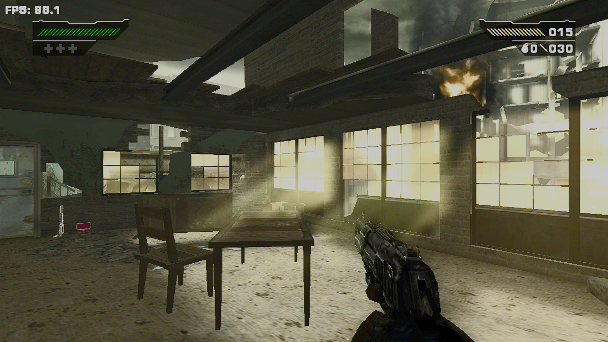
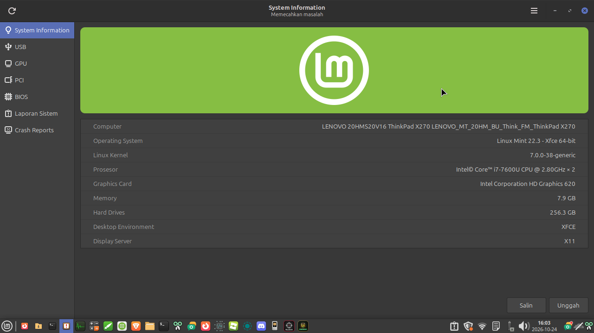
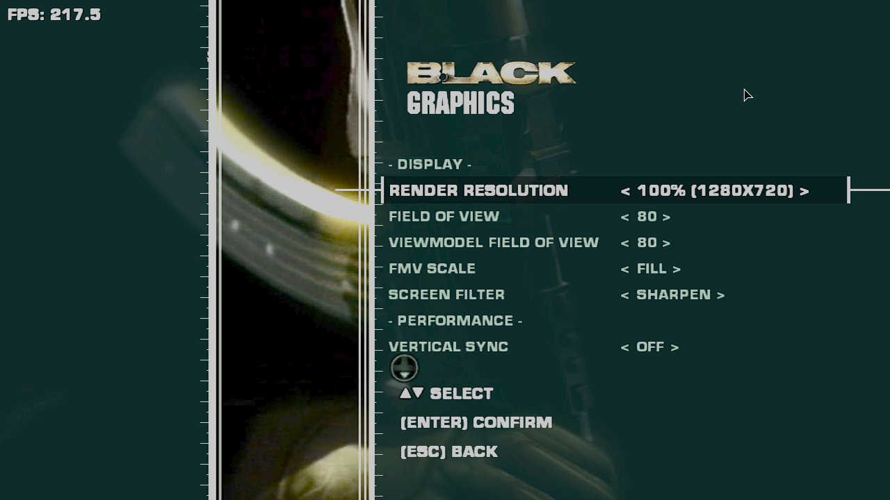
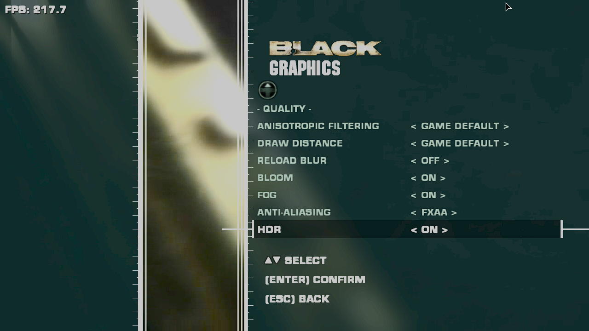

# Black (Xbox, 2006) — Native Linux Port

**English** | [Bahasa Indonesia](README.id.md)

A **native Linux x86_64** port of the original Xbox version of *Black*, built using **static recompilation**: the game's x86 code is translated into C++ and compiled into a native Linux executable (ELF).

This is **not** an emulator, Wine/Proton, Electron, or a web engine. Graphics use **Vulkan**, while **SDL3** handles the window, audio, keyboard, mouse, and controllers.

> ⚠️ **This package contains NO game code or game assets.** You must provide your own copy of the game (USA or Europe), either as an `.iso` or an extracted folder containing `default.xbe`. Black is © Criterion Games / Electronic Arts. This is an unofficial project.

**Download:** get `black-linux_<version>_amd64.deb` from [Releases](https://github.com/Katon17/black-linux/releases).

**Target platforms:** Ubuntu 24.04 / Linux Mint 22.x (x86_64).

## Benchmark

*Reported by the tester on their own hardware; performance may vary. The sustained range below is an observation, not a frame-time capture or a measured average.*

| Item | Details |
|---|---|
| Laptop | Lenovo ThinkPad X270 |
| CPU / GPU | Intel Core i7-7600U / Intel HD Graphics 620 |
| RAM | 8 GB, **single-channel** |
| OS | Linux Mint 22.3 XFCE, X11 |
| Kernel / Mesa | `7.0.0-38-generic` / `25.2.8` |
| Resolution | 1280×720, 100% render scale |
| Settings | V-Sync off; maximum FPS: **Unlimited**; FXAA; bloom, fog, and HDR on; anisotropic filtering and draw distance at game defaults; reload blur off |
| Test scene | Mission 1; the most demanding area reported was the sunlit brick room with large windows |
| Observed performance | Stable **80–100 FPS** during the first three missions |
| Instantaneous readings | **98.1 FPS** facing the bright windows; **139.0 FPS** facing the door |

### Gameplay on Linux Mint XFCE



*Mission 1, facing the sunlit windows: 98.1 FPS at the moment of capture.*

[Second gameplay screenshot: facing the door, 139.0 FPS](docs/benchmarks/mission-1-door.png).
These are instantaneous readings, not average FPS or minimum/maximum results for a full run.

<details>
<summary>Test system and graphics settings</summary>







The system and settings screenshots document the visible configuration. Single-channel RAM, Mesa version, Unlimited FPS, and performance across three missions were reported by the tester. FPS shown in the settings menu is **not** gameplay performance.

</details>

---

## 1. Install

Download the `.deb` from Releases, then run:

```bash
sudo apt install ./black-linux_0.1.2_amd64.deb
```

`apt` automatically installs the required dependencies, including `clang`, `lld`, `libvulkan1`, `mesa-vulkan-drivers`, `python3`, and `zenity`. Expect approximately 150–250 MB of dependencies.

Before starting, check that Vulkan works:

```bash
sudo apt install vulkan-tools
vulkaninfo --summary | grep -i "deviceName\|apiVersion"
# On an Intel HD 620, expect Intel(R) HD Graphics 620 (KBL GT2) and apiVersion 1.3.x.
```

## 2. Add your game files

Place your own copy in:

```text
~/.local/share/black-linux/game/
    Black.iso                    # Disc image (USA or Europe), OR
    default.xbe + its folders     # Extracted game files
```

If this directory is empty, the launcher opens a dialog to select your `.iso` file.

## 3. First launch

Open **Games → Black (Linux Native)** from your application menu, or use a terminal to see progress:

```bash
black-linux-build      # Build only, with progress output
black-linux            # Play
```

The first launch **compiles the game for your PC**:

1. `default.xbe` is recompiled into C++ (64 parts).
2. The generated code is compiled with clang. **On an X270, this is estimated to take 30–90 minutes, once.**
3. Everything is linked into `~/.local/share/black-linux/bin/BLACK`.

Subsequent launches start the game directly.

## 4. Controls and settings

| Key / command | Action |
|---|---|
| `F11` or `Alt+Enter` | Toggle fullscreen / windowed mode |
| In-game Options menu | Graphics, Controller (stick deadzone/sensitivity), General, Mouse and Keyboard (rebindable), Cheats |
| `F10` | Settings overlay |
| `BLACK_TOUCH=1 black-linux` | Force touch controls to appear (for touchscreen laptops) |
| `BLACK_GPU=nvidia black-linux` | Select a GPU by name |
| `black-linux --windowed` | Start in a window |
| `black-linux --rebuild` | Rebuild the game |

**Recommended settings for Intel HD 620:**

- Render Resolution: 100% on a 1366×768 display, or approximately 67% at 1080p. This is set automatically on first launch.
- MSAA/SMAA: off.
- Ambient Occlusion: off.
- Draw Distance: 1x.
- V-Sync: on (default).

## 5. File locations

| Path | Contents |
|---|---|
| `~/.local/share/black-linux/black.toml` | Settings |
| `~/.local/share/black-linux/hdd/` | Saved games |
| `~/.local/share/black-linux/logs/` | Logs for troubleshooting |
| `~/.local/share/black-linux/bin/BLACK` | Compiled game executable |
| `~/.cache/black-linux/build.log` | Build log |

## 6. Troubleshooting

| Problem | Suggested solution |
|---|---|
| `compiling failed` | You may have run out of memory. Run `black-linux-build --jobs 1` (slower, but uses less RAM). |
| `the recompiler stopped` | The game may not be a USA/Europe release, or the ISO may be damaged. Check `build.log`. |
| Black screen or crash at startup | Try `sudo apt install --reinstall mesa-vulkan-drivers`, then include the contents of `logs/` when reporting the issue. |
| Android touch controls appear on screen | Fixed in 0.1.2. Update the `.deb`, then run `black-linux-build` (only relinks, approximately one minute). |
| A "different release" warning appears | Your game copy is a different version and will likely crash. |

---

## How it works

```text
 .deb PACKAGE (no game code)                    ON YOUR PC (once)
 ┌──────────────────────────────┐  default.xbe  ┌────────────────────────────────┐
 │ xbe_recomp (recompiler)      │ ─────────────▶ │ 64 generated C++ files         │
 │ libblack_host.a:             │               │        │ clang -O2              │
 │  - XboxXBE-Recomp runtime    │               │        ▼                        │
 │    (Xbox kernel, D3D8, DSnd) │   link        │ game objects + host = BLACK    │
 │  - game hooks/sound/D3D8     │ ─────────────▶ │ (native x86_64 ELF, Vulkan)     │
 │  - SDL3+Vulkan desktop host  │               └────────────────────────────────┘
 │ libSDL3.a, libglslang.a      │
 └──────────────────────────────┘
```

This project builds on:

- **XboxXBE-Recomp SDK** by TGP482 (MIT): portable recompiler and runtime, pinned to commit `99078b1`.
- **Black for Android** by RanggaCasper (MIT): `src/` (hooks, sound, D3D8) and the Vulkan renderer. The `desktop/` directory adapts the Android host for Linux desktop use.

### Desktop Linux changes

- `desktop/main.cpp`: desktop window (fullscreen/windowed, F11), XDG data directories, system information from `/proc`, and laptop-friendly defaults.
- `desktop/game_files.cpp`: finds the game in `~/.local/share/black-linux/game`, `~/Games/Black`, or `$BLACK_GAME_DIR`. JNI/Android code removed.
- `desktop/input.cpp`, `update.cpp`, `touch.cpp`: JNI code removed; skin paths point to `/usr/share`.
- `desktop/vulkan.cpp`: Vulkan surfaces no longer require an Android window (the cause of the `renderer init failed` crash in 0.1.0). Automatic GPU selection prefers discrete, then integrated GPUs.
- `desktop/touch.cpp`: touch controls are hidden by default; keyboard/mouse is the initial input mode. The overlay appears when the touchscreen is actually used.
- `src/common/menu.cpp`: Touch/Gyro pages replaced with Controller; Android-only "Check for updates" menu removed.
- `src/d3d/render_thread.cpp`: **SSE2** implementation for x86_64 added for state comparisons previously using ARM NEON.
- `sdk/tools/recomp/main.cpp`: `XBE_HEADER_ONLY` mode allows building the host without game files.

### Build the .deb from source (no game files required)

On Ubuntu 24.04 / Linux Mint 22.x (x86_64):

```bash
./build-from-source.sh
sudo apt install ./release/black-linux_*.deb
```

## Test status (version 0.1.2)

The following results are recorded for the project; they do not imply testing on all hardware.

| Component | Status |
|---|---|
| Recompilation from an original USA ISO (SHA-1 `82d05881…`) on ThinkPad X270 | ✅ |
| Vulkan renderer on Intel HD 620 | ✅ Running smoothly since 0.1.1 |
| Android touch controls hidden on laptops | ✅ 0.1.2 |
| Host updates without a full recompile (object cache) | ✅ Since 0.1.1 |

## Credits

- **XboxXBE-Recomp SDK** by TGP482 (MIT): `sdk/`.
- **Black for Android** by Rangga Casper (MIT): `src/`, `desktop/`, `config/`, `data/`.
- Third-party libraries (SDL3, Dear ImGui, glslang, Zydis, toml++) are downloaded during the build. See `sdk/THIRD_PARTY.txt`.
- Linux desktop port and `.deb` packaging: **Katon17**.

License: MIT (see `LICENSE`).
